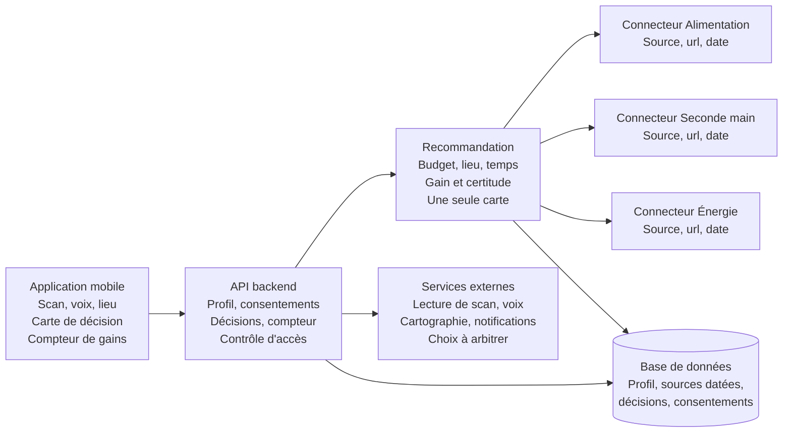

# Spécifications techniques – Hooka (concept A)

17 novembre 2026

## 1. Contexte et objectifs

Hooka est une application mobile qui propose, au moment du choix, une alternative écologique adaptée au budget, au lieu et au temps de l'utilisateur (25-35 ans). Le MVP couvre trois domaines : alimentation, seconde main (tous types d'objets) et énergie. Le nom de l'app reste à définir.

Ce document dit ce que l'équipe de développement doit construire pour le concept A. Il découle du parcours « Hooka » validé en userflow. La stack, les partenaires de données et la volumétrie ne sont pas arrêtés : ils figurent comme décisions ouvertes (sections 2 et 14).

| HMW | Traduction technique |
| --- | --- |
| 1. Décider vite | Un moteur de recommandation renvoie une seule carte, filtrée par budget, position et temps disponible, sans saisie de recherche. |
| 2. Double bonus | Chaque carte affiche d'abord le gain concret (euros, temps), puis l'impact écologique, avec les hypothèses de calcul visibles. |
| 3. Valoriser | Mini-bilan initial de ce que la personne fait déjà, messages de félicitation, aucun score négatif ni message culpabilisant. |
| 4. Confiance vérifiable | Chaque donnée porte une source, une date de mise à jour et un niveau de certitude. Les adresses non revérifiées récemment sont signalées. |
| 5. Pas à pas | Un seul geste suivant proposé à la fois, choisi selon le niveau de départ et le domaine. |

**Cadre du prototype.** Le MVP est un prototype testé auprès de 30 à 50 personnes du profil cible, recrutées sur 4 semaines. Il n'a pas d'objectif de revenu : il doit prouver que l'app est utilisée au moment du choix, que la carte unique déclenche la décision et que les utilisateurs lui font confiance. La métrique North Star est le nombre de cartes validées par utilisateur actif et par semaine. Une carte est validée quand la personne appuie sur « Valider » : c'est déclaratif, donc à recouper par des entretiens.

Les sept objectifs ci-dessous et leurs cibles viennent du contexte produit fourni par l'équipe. Ce sont des propositions de départ : avec 30 à 50 testeurs, elles servent à décider d'itérer ou non, pas à faire des statistiques.

| # | Objectif | Cible proposée |
| --- | --- | --- |
| O1 | Prouver que l'app s'utilise au moment du choix | 60 % des sessions démarrent par un scan, une question ou un lieu détecté |
| O2 | Prouver que la carte unique déclenche la décision | 30 % des cartes affichées sont validées ; 50 % des testeurs valident une carte en session 1 |
| O3 | Prouver que la confiance est acquise | 80 % des testeurs jugent les informations « fiables » ou « très fiables » |
| O4 | Prouver que le ton valorise sans culpabiliser | Moins de 10 % des testeurs se sentent « culpabilisés » |
| O5 | Prouver que l'usage devient une habitude | 40 % des testeurs reviennent au moins 3 fois en 4 semaines |
| O6 | Mesurer la demande pour la suite | Classement des domaines verrouillés et des demandes hors domaines |
| O7 | Constituer une base de test | 30 à 50 testeurs dans le profil cible, recrutés sur 4 semaines |

## 2. Périmètre

Le MVP compte 9 écrans (E1 à E9) qui suivent le userflow, du besoin détecté à la validation, sur trois domaines : alimentation, seconde main et énergie.

**Dans le MVP**

- Neuf écrans : onboarding, mini-bilan, accueil Réflexe, capture du besoin, carte unique de décision, « Pourquoi ? », action lancée, confirmation et geste suivant, foyer et réglages (section 3).
- Aucun compte obligatoire pour arriver à l'accueil.
- Trois domaines actifs. Les autres domaines sont affichés avec la mention « bientôt » et un bouton « Me prévenir ».
- Trois entrées : scan (produit, étiquette ou facture), demande en texte ou en dictée vocale, lieu détecté.
- Données limitées à 1 ou 2 villes et à quelques enseignes, vérifiées à la main, avec la date visible.
- Chaque fonctionnalité est classée Indispensable ou Souhaitable. Les « Souhaitable » ne sont faites que si le temps le permet.

**Hors MVP (à confirmer avec l'équipe produit)**

- Les autres domaines (par exemple déplacements, numérique) : seulement la mention « bientôt » et l'enregistrement de la demande. L'architecture doit les accueillir sans refonte.
- Achat, réservation ou paiement dans l'app.
- Bilan mensuel partageable, défi de foyer, cagnotte.
- Import automatique de tickets de caisse. La facture n'est jamais conservée.
- Pistes de monétisation (partenariats B2B énergie, aides, collectivités ; offre premium) : à instruire après le MVP, sans les développer. Un partenariat avec des enseignes ne doit jamais influencer le choix de l'alternative proposée.
- Version web.

**Hypothèses de travail**

- Application mobile pour iOS et Android (à confirmer), en français, avec la France comme premier marché et 1 ou 2 villes pour le prototype.
- Les données de prix, de stocks et d'annonces sont vérifiées à la main sur ce périmètre. Les tenir à jour à plus grande échelle reste un risque (sections 8 et 14).
- Le scan de facture est simulé ou remplacé par des questions à choix dans le prototype (section 4).

## 3. Écrans et exigences fonctionnelles

Neuf écrans (E1 à E9) portent les exigences du MVP, de l'onboarding au geste suivant. Chaque ligne a une priorité : Indispensable (sans elle le prototype ne tient pas) ou Souhaitable (à inclure si le temps le permet). Le comportement attendu sert de critère d'acceptation pour le QA.

### E1. Première ouverture et onboarding

Objectif : arriver à l'accueil Réflexe en moins de 3 minutes, sans compte obligatoire.

| Fonctionnalité | Comportement attendu | Priorité |
| --- | --- | --- |
| Écran de bienvenue | Une phrase de promesse, un bouton « Commencer » | Indispensable |
| Choix des 3 domaines prioritaires | Alimentation, seconde main et énergie actifs. Les autres domaines sont affichés avec « bientôt » et un bouton « Me prévenir » | Indispensable |
| Budget | 3 niveaux (serré, équilibré, confortable), modifiable plus tard | Indispensable |
| Lieu | Ville ou code postal, plus enseignes habituelles (facultatif) | Indispensable |
| Temps disponible | 3 choix de temps habituel pour une décision (moins d'une minute, quelques minutes, je prends mon temps) | Indispensable |
| Autorisations | Demande de la caméra, du micro et de la localisation seulement au moment où la fonction sert, avec une phrase d'explication | Indispensable |
| Barre de progression | Indique les étapes restantes, retour arrière possible | À confirmer |

### E2. Mini-bilan

Objectif : partir de ce que la personne fait déjà de bien, sans questionnaire administratif.

| Fonctionnalité | Comportement attendu | Priorité |
| --- | --- | --- |
| Liste de gestes déjà faits | 5 à 6 gestes à cocher pour les 3 domaines choisis (par exemple vrac, seconde main, réglage du chauffage) | Indispensable |
| Passer l'étape | Bouton « Plus tard », aucune obligation | Indispensable |
| Retour positif | Message qui reprend les gestes cochés comme point de départ, sans note ni score | Indispensable |
| Réutilisation | Les gestes cochés alimentent la phrase de valorisation des cartes (E5) | Indispensable |

### E3. Accueil Réflexe

Objectif : lancer une décision en un geste, depuis n'importe quel moment de la journée.

| Fonctionnalité | Comportement attendu | Priorité |
| --- | --- | --- |
| Bouton « Scanner » | Ouvre la caméra pour un produit, une étiquette ou une facture | Indispensable |
| Bouton « Demander » | Champ de texte, avec dictée vocale si elle est disponible | Indispensable |
| Lieu détecté | Si l'autorisation est donnée, propose le domaine du moment selon le lieu (supermarché, magasin de bricolage) ; sinon choix manuel du lieu | Indispensable |
| Domaine du moment | Les 3 domaines choisis en premier, les autres accessibles en second | Indispensable |
| Demande hors domaines | Réponse honnête (« pas encore ») et enregistrement de la demande | Indispensable |
| Rappel positif | Une ligne sobre, par exemple le nombre de décisions validées ce mois-ci | Souhaitable |
| Notification de lieu | Rappel déclenché par un lieu, activable, au maximum un par jour | Souhaitable |

### E4. Capture du besoin, selon le domaine

Objectif : comprendre le besoin en moins de 30 secondes.

| Domaine | Fonctionnalité | Comportement attendu | Priorité |
| --- | --- | --- | --- |
| Alimentation | Scan d'un produit ou photo de l'étiquette | Reconnaît le produit, confirme en un tap, passe à la carte | Indispensable |
| Alimentation | Produit non reconnu | Propose de saisir le nom, ne bloque jamais | Indispensable |
| Seconde main | Besoin exprimé | « Il me faut une perceuse » en texte ou à la voix, accessible pour tous les domaines | Indispensable |
| Seconde main | Précision | Une seule question de suite au maximum (usage, budget) | Souhaitable |
| Énergie | Scan de la facture ou question | Lit les informations utiles ou accepte une question comme « je chauffe trop » | Indispensable |
| Énergie | Facture non lisible | Propose 2 ou 3 questions à choix à la place | Indispensable |
| Tous | Confidentialité | Mention claire de ce qui est conservé ; la facture n'est pas conservée | Indispensable |

### E5. Carte unique de décision

Objectif : une seule alternative, décidable en 30 secondes.

| Fonctionnalité | Comportement attendu | Priorité |
| --- | --- | --- |
| 1. Gain concret | Euros et temps affichés en premier, avant l'impact écologique | Indispensable |
| 2. Ce que je fais déjà de bien | Phrase tirée du mini-bilan, par exemple « tu prends déjà le vrac, cette option va dans le même sens » | Indispensable |
| 3. Pastille de source | Source, date et niveau de certitude (solide, probable, contesté), avec lien vers l'origine | Indispensable |
| Impact écologique | Équivalence parlante, en second plan | Indispensable |
| Alternative selon le domaine | Alimentation : même prix ou moins cher, dans le magasin où l'on est. Seconde main : meilleure option proche, prix comparé au neuf, état, distance, horaires vérifiés. Énergie : geste ou aide adaptés (réglage, équipement, aide à demander) | Indispensable |
| Filtre budget, lieu, temps | La carte tient compte des réglages de l'onboarding | Indispensable |
| Adresse non vérifiée récemment | Signalée sur la carte comme telle | Indispensable |
| Bouton « Valider » | Lance l'action (E7) | Indispensable |
| Bouton « Pourquoi ? » | Ouvre le détail (E6) | Indispensable |
| Bouton « Passer » | Message « aucune pénalité », l'app retient la préférence, retour à l'accueil ; raison en un tap facultative | Indispensable |
| Le produit de départ n'est jamais jugé | Aucun mot négatif sur le produit scanné | Indispensable |

### E6. Pourquoi ? Détail des sources et des incertitudes

Objectif : permettre à ceux qui veulent vérifier de le faire en un tap.

| Fonctionnalité | Comportement attendu | Priorité |
| --- | --- | --- |
| Sources cliquables | Liste des sources avec date de dernière vérification | Indispensable |
| Méthode de calcul | Comment le gain et l'impact sont calculés | Indispensable |
| Incertitudes | Ce qui n'est pas sûr, et les désaccords d'experts quand ils existent | Indispensable |
| Retour à la décision | Un bouton ramène à la carte (E5) | Indispensable |
| Signaler une erreur | Pour une adresse, un prix ou une donnée fausse ou périmée | Indispensable |

### E7. Action lancée

Objectif : passer à l'acte sans quitter l'app avant d'avoir de quoi agir.

| Fonctionnalité | Comportement attendu | Priorité |
| --- | --- | --- |
| Itinéraire | Ouvre l'itinéraire vers le magasin ou le lieu proposé | Indispensable |
| Mise de côté | Garde l'alternative dans une liste pour plus tard | Indispensable |
| Démarche pré-remplie | Pour l'énergie, prépare la démarche ou le message de demande d'aide | Souhaitable |
| Retour rapide | Bouton pour revenir à l'accueil | Indispensable |

### E8. Confirmation et geste suivant

Objectif : marquer le petit pas, puis proposer le suivant.

| Fonctionnalité | Comportement attendu | Priorité |
| --- | --- | --- |
| Gain ajouté au compteur du foyer | Euros et impact ajoutés au total cumulé | Indispensable |
| Message de félicitation sobre | Une phrase factuelle, sans compliment excessif | Indispensable |
| Geste suivant | Un seul geste proposé, dans le même domaine | Indispensable |
| Retour à l'accueil | Bouton secondaire pour s'arrêter là | Indispensable |
| Question de ressenti | « Comment vous sentez-vous ? » avec 3 réponses, facultative | Souhaitable |

### E9. Mon foyer et réglages

| Fonctionnalité | Comportement attendu | Priorité |
| --- | --- | --- |
| Compteur du foyer | Euros économisés, nombre de décisions validées, impact en équivalences, historique daté | Indispensable |
| Gestes déjà faits | Liste du mini-bilan, modifiable | Indispensable |
| Modifier mes réglages | Domaines, budget, lieu, enseignes, temps disponible | Indispensable |
| Permissions | Activer ou couper caméra, micro, localisation, notifications | Indispensable |
| Sources et méthode | Page expliquant d'où viennent les données et comment signaler une erreur | Indispensable |
| Données personnelles | Export et suppression des données | Souhaitable |

Deux priorités sont déduites faute de lecture claire du document source : la barre de progression (E1) est marquée « À confirmer », et l'export et la suppression des données (E9) sont lus comme Souhaitable pour le prototype. Ils restent à prévoir avant toute mise en ligne publique (section 11).

## 4. Les trois domaines du MVP

Les trois domaines partagent le même pipeline (entrée, recommandation, carte, décision) et ne diffèrent que par leurs entrées, leurs données et l'action à la validation. Les sources de données sont des pistes à évaluer, aucune n'est retenue à ce stade.

|  | Alimentation | Seconde main (tous domaines) | Énergie |
| --- | --- | --- | --- |
| Entrées | Scan d'un produit au rayon, photo d'étiquette | Besoin exprimé en texte ou à la voix (outil, vêtement, meuble, électronique…) | Scan de facture, question (« je chauffe trop ») |
| Ce que la carte propose | Alternative au même prix ou moins chère, dans le magasin où se trouve la personne | Options de seconde main proches : prix comparé au neuf, état, distance, horaires | Geste, réglage, équipement ou aide adaptés, avec gain mensuel estimé |
| Filtres appliqués | Budget, magasin courant, temps disponible | Budget, distance, temps disponible | Budget, type de logement et de contrat, temps disponible |
| Action à la validation | Mise de côté du produit, itinéraire vers le magasin | Itinéraire, contact, mise de côté | Démarche pré-remplie, tutoriel court |
| Données nécessaires | Catalogue produits, prix et disponibilité par magasin, labels | Annonces et adresses de seconde main, réparateurs, ressourceries, horaires | Tarifs, aides disponibles, caractéristiques d'équipements |
| Pistes de sources à évaluer | Base de produits ouverte (par exemple Open Food Facts), données des enseignes | Plateformes de seconde main, annuaires locaux | Sources officielles pour tarifs et aides (à vérifier, ces données évoluent vite) |
| Point d'attention | Disponibilité des prix par magasin, mentions « vertes » non fiables | Péremption des annonces et des adresses | Exactitude des aides et des tarifs, personnalisation par logement |

**Contraintes du prototype.** Les données de magasins, de prix et de stocks couvrent 1 ou 2 villes et quelques enseignes, vérifiées à la main. La facture est simulée ou remplacée par 2 ou 3 questions à choix, et aucune facture n'est conservée. L'énergie n'apparaît dans aucun entretien : c'est l'hypothèse H8, à tester. Les transports, cités dans plusieurs entretiens, sont le domaine de remplacement envisagé.

## 5. Architecture proposée

Une API unique relie l'application aux services. Le moteur de recommandation interroge trois connecteurs de données qui respectent le même contrat : une source, une url et une date de vérification. Ce découpage est une proposition à arbitrer avec l'équipe (section 14).

La carte revient par le chemin inverse. Un nouveau domaine s'ajoute en branchant un connecteur de plus, sans toucher au moteur.

## 6. Modèle de données

Le modèle proposé compte douze entités. Le fil conducteur : une `Recommandation` est toujours reliée à au moins une `Source` datée, et une `Decision` à une seule `Recommandation`. Les noms et types sont indicatifs et à adapter à la base choisie.

| Entité | Champs clés | Remarques |
| --- | --- | --- |
| `Utilisateur` | id, créé le, niveau de départ par domaine | Aucun compte obligatoire pour arriver à l'accueil (E1) : l'identifiant reste anonyme tant que la personne ne crée pas de compte. Le choix de l'identifiant est à arrêter. |
| `Profil` | niveau de budget (serré, équilibré, confortable), ville ou code postal, enseignes habituelles, temps habituel pour une décision | Modifiable depuis E9. La localisation précise n'est stockée que si elle est consentie. |
| `DomainePrioritaire` | utilisateur, domaine, rang | Alimentation, seconde main et énergie sont actifs dans le prototype. Les autres domaines sont verrouillés. |
| `GesteEnPlace` | utilisateur, domaine, libellé, origine (mini-bilan ou validé dans l'app) | Cochés en E2, modifiables en E9. Alimentent la phrase de valorisation de la carte (E5). |
| `Besoin` | utilisateur, entrée (scan, texte, voix, lieu), domaine déduit, contenu, horodatage | Le contenu brut d'un scan ou d'une photo n'est pas conservé au-delà du traitement. La facture n'est jamais conservée. |
| `Demande` | utilisateur, type (hors domaines, produit non reconnu, « Me prévenir »), domaine ou texte, horodatage | Alimente les indicateurs « Demandes sans réponse » et « Domaines verrouillés ». |
| `Source` | id, nom, url, type, date de dernière vérification, fiabilité | Une donnée non vérifiée récemment est signalée sur la carte. |
| `Recommandation` | besoin, domaine, alternative, gain en euros, gain en temps, impact (équivalence), hypothèses, niveau de certitude (solide, probable, contesté), sources, avertissement « non vérifié récemment » | Sans source datée, elle n'est pas affichable. |
| `Decision` | recommandation, réponse (validée, passée), raison facultative de « Passer », ressenti facultatif (encouragé, neutre, culpabilisé), horodatage | Une décision « passée » met à jour les préférences, sans autre conséquence. Une carte validée est déclarative. |
| `MiseDeCote` | utilisateur, recommandation, date | Liste d'alternatives gardées pour plus tard (E7). |
| `Signalement` | utilisateur, objet (adresse, prix, donnée), motif, statut, date de création et de correction | Permet de mesurer le délai de correction (cible : sous 7 jours). |
| `Consentement` | utilisateur, finalité (localisation, caméra, micro, notifications), accord, date | Chaque finalité est gérée séparément et retirable, et demandée au moment où la fonction sert. |

## 7. Moteur de recommandation

Le moteur transforme un besoin en une seule carte, ou en un refus explicite quand aucune alternative n'est fiable. Les chiffres et les sources viennent toujours de données et de règles vérifiables : si un modèle de langage est utilisé, il sert à comprendre la demande et à reformuler, jamais à produire un montant ni une source.

1. Normaliser le besoin (scan, texte, voix ou lieu) en une demande structurée.
2. Identifier le domaine, ou poser une seule question de clarification si c'est ambigu.
3. Récupérer les alternatives candidates auprès des sources du domaine.
4. Filtrer selon le budget, le lieu, le temps disponible et la fraîcheur des sources.
5. Classer les candidates et retenir la meilleure.
6. Calculer le gain en euros et en temps, puis l'impact écologique, avec leurs hypothèses.
7. Assembler la carte : gain, existant valorisé, source, date et niveau de certitude.
8. S'il ne reste aucune alternative fiable, afficher un message honnête au lieu d'une proposition faible.

**Règles à implémenter**

- Une alternative n'est retenue que si elle respecte les filtres de budget et de lieu de l'utilisateur.
- Le niveau de certitude (solide, probable, contesté) est dérivé de la qualité et de l'ancienneté des sources, pas saisi à la main carte par carte.
- Le geste suivant est choisi dans le même domaine selon le niveau de départ et les gestes déjà en place. La règle de classement exacte (pondération gain, effort, délai) est à définir avec l'équipe produit.
- Les hypothèses de calcul sont stockées avec la recommandation pour pouvoir être affichées.

## 8. Données, sources et confiance vérifiable

Aucune information n'est affichée sans source ni date : c'est la règle qui porte la promesse « confiance vérifiable » et qui protège contre le greenwashing et les adresses périmées.

| Exigence | Règle technique |
| --- | --- |
| Traçabilité | Chaque donnée importée garde son `Source`, son url et sa date de dernière vérification. Le lien vers la source est accessible depuis la carte. |
| Fraîcheur | Chaque type de donnée a une durée de validité (prix, annonce, adresse, aide). Au-delà, la donnée est exclue des recommandations ou affichée comme non vérifiée récemment. Les durées sont à définir par domaine avec l'équipe produit. |
| Niveau de certitude | Trois niveaux affichés : solide, probable, contesté. Calculés à partir de la nature et de l'ancienneté des sources. |
| Anti-greenwashing | Une mention écologique (label, argument marketing) n'est reprise que si elle est rattachée à un référentiel identifié, cité sur la carte. Sinon, elle est ignorée ou signalée comme non vérifiée. |
| Adresses périmées | Un utilisateur peut confirmer ou signaler une adresse fermée en un geste. Un signalement met l'adresse en attente de revérification. |
| Incertitudes | L'app affiche ce qu'elle ne sait pas (hypothèse manquante, donnée ancienne) dans l'écran « Pourquoi ? ». |
| Aides et tarifs | Toute aide ou tout tarif affiché est à faire vérifier à la source officielle, et la carte renvoie vers elle. |

## 9. API et intégrations

L'application mobile parle à un backend unique par une API REST dont les quinze routes ci-dessous couvrent le MVP. Aucun compte n'étant obligatoire, l'authentification doit accepter un utilisateur anonyme. Le format, le versionnement et l'authentification sont à arrêter avec l'équipe backend ; les routes sont indicatives.

| Méthode | Route | Rôle |
| --- | --- | --- |
| POST | `/v1/onboarding` | Enregistre le profil, les domaines et le mini-bilan (E1, E2). |
| GET, PATCH | `/v1/profil` | Lit et modifie budget, lieu, enseignes, temps disponible (E9). |
| GET, PUT | `/v1/gestes` | Lit et modifie les gestes déjà faits (E2, E9). |
| POST | `/v1/besoins` | Crée un besoin (scan, texte, voix, lieu) et renvoie la carte de décision (E4, E5). |
| POST | `/v1/demandes` | Enregistre une demande hors domaines, un produit non reconnu ou un « Me prévenir ». |
| GET | `/v1/recommandations/{id}/sources` | Renvoie le détail des sources, de la méthode et des incertitudes (E6). |
| POST | `/v1/recommandations/{id}/decision` | Enregistre la réponse (validée ou passée, avec raison facultative). |
| POST | `/v1/recommandations/{id}/ressenti` | Enregistre la réponse facultative à la question de ressenti (E8). |
| POST | `/v1/mises-de-cote` | Garde une alternative pour plus tard (E7). |
| GET | `/v1/geste-suivant` | Renvoie le geste suivant pour un domaine (E8). |
| GET | `/v1/compteur` | Renvoie les gains cumulés du foyer, l'historique daté et les hypothèses (E9). |
| POST | `/v1/signalements` | Signale une adresse, un prix ou une donnée fausse ou périmée (E6). |
| PUT | `/v1/consentements/{finalite}` | Accorde ou retire un consentement (E1, E9). |
| GET | `/v1/export` | Exporte les données de l'utilisateur (E9). |
| DELETE | `/v1/compte` | Supprime les données associées à l'utilisateur (E9). |

**Intégrations externes à prévoir**

- Lecture de code-barres et reconnaissance de texte sur photo (sur l'appareil ou via un service, à arbitrer).
- Reconnaissance vocale.
- Cartographie et itinéraire pour les magasins et adresses de seconde main.
- Notifications push.
- Sources de données des trois domaines (section 4), chacune derrière un connecteur dédié qui renvoie source, url et date de vérification.

## 10. Exigences non fonctionnelles

La vitesse de réponse est l'exigence qui compte le plus : la carte doit arriver pendant que la personne est encore devant le produit. Les cibles de durée viennent du contexte produit. Les seuils techniques de temps de réponse restent à fixer avec l'équipe.

| Sujet | Exigence |
| --- | --- |
| Performance | Cibles produit : besoin compris en moins de 30 secondes, carte décidable en 30 secondes, durée de décision médiane sous 1 minute, première carte en moins de 3 minutes après l'ouverture. Le temps technique d'affichage de la carte reste à définir et se mesure de bout en bout. Un indicateur de chargement s'affiche en attendant. |
| Disponibilité | Si une source de données ne répond pas, l'app le dit et propose de réessayer, sans afficher de donnée périmée comme si elle était fraîche. |
| Mode dégradé | Sans réseau, l'app indique clairement ce qui n'est pas disponible. Les gains déjà validés et le profil restent consultables. |
| Accessibilité | Objectif de conformité à définir (par exemple RGAA). Contrastes, tailles de texte, lecteurs d'écran, alternative à la voix et au scan. |
| Ton et textes | Aucun message culpabilisant. Les textes sont relus par l'équipe produit avant mise en ligne. |
| Évolutivité | Un nouveau domaine s'ajoute en branchant un connecteur de données et des règles, sans modifier le pipeline. |
| Observabilité | Journaux et alertes sur les échecs de scan, les sources en erreur et les recommandations refusées faute de source fiable. |

## 11. Sécurité et données personnelles

Le concept manipule des données sensibles par nature (localisation, photos, factures) : le principe est de n'en collecter que le minimum, avec un consentement par finalité. Cette section est une première base technique. Elle doit être validée par une personne compétente (DPO ou juriste) avant le développement, notamment sur la nécessité d'une analyse d'impact.

**Protection des données**

- Consentements séparés et retirables pour la localisation, les photos et les notifications. L'app reste utilisable sans localisation, par saisie d'une ville.
- Photos de produits, d'étiquettes ou de factures : traitées pour produire la recommandation, puis supprimées. La facture n'est jamais conservée : seul le résultat utile à la recommandation est gardé (à préciser avec l'équipe produit).
- Données de localisation précises non conservées au-delà de la session. Aucun suivi continu en arrière-plan sans consentement explicite.
- Droits des personnes : accès, export (`/v1/export`) et suppression (`/v1/compte`) disponibles depuis l'app.
- Lieu d'hébergement et sous-traitants à définir ; l'hébergement dans l'Union européenne est l'hypothèse de départ.

**Sécurité technique**

- Chiffrement des communications et des données stockées.
- Aucun secret en dur dans le code ni dans l'application mobile : clés d'API et jetons stockés dans un gestionnaire de secrets, et appels aux services tiers faits depuis le backend uniquement.
- Authentification et autorisation sur toutes les routes, contrôle d'accès : un utilisateur ne lit que ses propres données.
- Journaux sans données personnelles.
- Validation des entrées, notamment des images et du texte envoyés par l'utilisateur.

Dans le prototype, l'export et la suppression des données (E9) sont classés Souhaitable. Ils restent à prévoir avant toute mise en ligne publique.

## 12. Mesure et analytics

La mesure doit dire si l'app aide vraiment à décider vite et à passer à l'action, sans surveiller l'utilisateur : événements pseudonymisés, sans contenu de scan ni localisation précise, et soumis au consentement. Les cibles viennent du contexte produit : ce sont des propositions de départ.

| Événement | Déclenché quand | Propriétés |
| --- | --- | --- |
| `onboarding_terminé` | L'onboarding est validé | Domaines actifs |
| `mini_bilan_complété` | Au moins un geste est coché | Nombre de gestes |
| `permission_décidée` | Une autorisation est accordée ou refusée | Type (caméra, micro, lieu, notifications), réponse |
| `besoin_créé` | Un scan, une demande ou un lieu déclenche un besoin | Entrée, domaine |
| `scan_échec` | La lecture d'un scan échoue | Type de scan |
| `demande_enregistrée` | Demande hors domaines, produit non reconnu ou « Me prévenir » | Type, domaine |
| `carte_affichée` | Une carte est montrée | Domaine, niveau de certitude, avertissement « non vérifié récemment », délai depuis le besoin |
| `carte_refusée_sans_source` | Aucune alternative fiable n'est trouvée | Domaine, motif |
| `pourquoi_ouvert` | L'écran des sources est ouvert | Domaine |
| `decision_enregistrée` | L'utilisateur valide ou passe | Réponse, raison facultative, domaine, délai de décision |
| `mise_de_côté` | Une alternative est gardée pour plus tard | Domaine |
| `geste_suivant_affiché` | Un geste suivant est proposé | Domaine |
| `ressenti_donné` | La question de ressenti reçoit une réponse | Encouragé, neutre ou culpabilisé |
| `signalement_créé` | Une adresse, un prix ou une donnée est signalé faux ou périmé | Type d'objet, domaine |

**Indicateurs suivis** : dix-neuf indicateurs, regroupés par catégorie. Les cibles sont des propositions de départ ; avec 30 à 50 testeurs, elles servent à décider d'itérer ou non.

| Catégorie | Métrique | Définition | Cible proposée |
| --- | --- | --- | --- |
| Activation | Onboarding terminé | Utilisateurs qui arrivent à l'accueil, sur ceux qui ouvrent l'app | 80 % |
| Activation | Mini-bilan complété | Utilisateurs qui cochent au moins un geste | 70 % |
| Activation | Délai avant la première carte | Temps entre l'ouverture et la première carte affichée | Moins de 3 minutes |
| Activation | Première carte validée | Utilisateurs avec une carte validée en session 1 | 50 % |
| Usage | Sessions déclenchées au moment du choix | Sessions qui démarrent par scan, question ou lieu détecté, sur toutes les sessions | 60 % |
| Usage | Durée de décision | Temps médian entre le déclenchement et « Valider » ou « Passer » | Moins de 1 minute |
| Usage | Répartition par domaine | Cartes affichées par domaine | Suivi, pas de cible |
| Qualité de la carte | Cartes validées | Cartes validées sur cartes affichées | 30 % |
| Qualité de la carte | Cartes passées | Répartition des raisons de « Passer » quand elles sont données | Suivi, pas de cible |
| Qualité de la carte | Demandes sans réponse | Demandes hors des 3 domaines ou produits non reconnus | Suivi, pour prioriser la suite |
| Confiance | Note de fiabilité | Question « Les informations vous semblent-elles fiables ? » sur 5 | 4 ou plus pour 80 % |
| Confiance | Ouverture de « Pourquoi ? » | Cartes pour lesquelles le détail est ouvert | Suivi, pas de cible |
| Confiance | Signalements d'erreur | Adresses, prix ou données signalés faux, délai de correction | Correction sous 7 jours |
| Confiance | Cartes avec une donnée non vérifiée récemment | Part des cartes affichant l'avertissement | Moins de 10 % |
| Valorisation | Ressenti après validation | Question en E8 : encouragé, neutre ou culpabilisé | Moins de 10 % culpabilisés |
| Rétention | Retour à 7 jours | Utilisateurs de retour 7 jours après la première session | 30 % |
| Rétention | Retour régulier | Utilisateurs revenus au moins 3 fois en 4 semaines | 40 % |
| Permissions | Acceptation | Part des utilisateurs qui autorisent caméra, micro et lieu | Suivi, pas de cible |
| Demande | Domaines verrouillés | Taps sur « Me prévenir » par domaine | Classement |

## 13. Tests et critères de recette

La recette repose d'abord sur les cas où l'app doit refuser de recommander : ce sont eux qui protègent la confiance. Chaque ligne des écrans E1 à E9 (section 3) se vérifie par son comportement attendu, en commençant par les lignes Indispensable.

| Niveau | Ce qui est testé |
| --- | --- |
| Unitaire | Calcul des gains et des hypothèses, filtres budget et lieu, déduction du niveau de certitude, règle « pas de carte sans source datée ». |
| Intégration | Chaque connecteur de données renvoie source, url et date. Comportement quand une source est en erreur ou renvoie une donnée ancienne. |
| Bout en bout | Les trois domaines, de l'entrée (scan, demande, lieu) à la validation, jusqu'au geste suivant. |
| Contenu et ton | Relecture des textes par l'équipe produit : aucun message culpabilisant, aucun score négatif. |
| Sécurité et données | Contrôle d'accès par utilisateur, suppression effective des photos après traitement, retrait des consentements, export et suppression du compte. |
| Accessibilité | Vérification selon l'objectif retenu en section 10. |

**Cas limites à couvrir**

- Produit ou document non reconnu.
- Aucune alternative fiable : l'app le dit.
- Source périmée ou en erreur.
- Permission de localisation, de caméra ou de micro refusée.
- Pas de réseau.
- Demande ambiguë : une seule question de clarification.
- Réponse « passer » répétée : aucune conséquence négative ni insistance.

## 14. Risques, questions ouvertes et phasage

Le risque principal est l'accès à des données fiables et à jour dans les trois domaines : tant que les sources ne sont pas choisies, la faisabilité du MVP n'est pas confirmée.

**Risques**

| Risque | Conséquence | Réponse prévue |
| --- | --- | --- |
| Les données de magasins, de prix et de stocks proches sont lourdes à tenir à jour | Adresses fausses, perte de confiance (une personne interrogée a supprimé une app pour cette raison) | Périmètre limité à 1 ou 2 villes et quelques enseignes, données vérifiées à la main, date visible, signalement « non vérifié récemment » |
| Le scan de facture est complexe et touche à des données personnelles | Retard, refus des utilisateurs | Prototype avec facture simulée ou questions à choix, aucune facture conservée |
| Une demande libre (voix ou texte) peut sortir des 3 domaines | Frustration, réponses hors sujet | Réponse honnête « pas encore » et enregistrement de la demande |
| Une app de moment est ouverte moins souvent qu'un journal | Rétention faible | Mesurer H9, notifications de lieu en option, un seul rappel par jour au maximum |
| La détection du lieu inquiète | Refus des permissions | Autorisation demandée au bon moment, choix manuel du lieu toujours possible |
| L'énergie n'apparaît dans aucun entretien | Domaine peu choisi | Tester H8, prévoir de le remplacer par les transports (cités dans plusieurs entretiens) |
| Une seule alternative laisse peu de choix | Les profils analytiques se sentent enfermés | « Pourquoi ? » donne les sources, les méthodes et les incertitudes |
| Le mini-bilan ressemble à un formulaire (« formulaire administratif » dans un entretien) | Abandon à l'onboarding | 5 à 6 gestes à cocher, étape facultative |
| Les cartes validées sont déclaratives | Taux de réalisation surestimé | L'assumer dans le MVP, recouper par entretiens de suivi |
| 5 entretiens de janvier 2025 seulement | Hypothèses datées et peu nombreuses | Faire 5 à 8 entretiens de validation du concept avant ou pendant le test |
| Qualité de la lecture de scan et de la voix | Parcours décourageant au moment du choix | Saisie manuelle toujours possible, mesure des échecs (section 12) |
| Estimations de gains contestables | Promesse jugée trompeuse | Hypothèses affichées, niveau de certitude, sources officielles |

**Décisions à prendre avant le développement**

| Décision | Pourquoi elle bloque |
| --- | --- |
| Stack mobile et backend | Conditionne l'architecture détaillée et l'organisation de l'équipe. |
| Sources de données retenues par domaine | Conditionne la faisabilité et le coût de chaque domaine. |
| Traitement des scans et de la voix : sur l'appareil ou via un service | Conditionne la vie privée, le délai et le coût. |
| Usage ou non d'un modèle de langage pour la demande en langage naturel | Conditionne l'architecture et la maîtrise des réponses. |
| Durées de validité par type de donnée | Nécessaire aux règles de fraîcheur. |
| Seuils de performance et objectif d'accessibilité | Nécessaires à la recette. |
| Nom de l'app | Nécessaire aux stores et à l'identité visuelle. |

**Phasage proposé (sans durées, à chiffrer avec l'équipe)**

1. Socle : profil, onboarding, modèle de données, pipeline de recommandation et carte de décision, avec un domaine pilote à choisir.
2. Extension aux trois domaines et à leurs trois entrées (scan, demande, lieu).
3. Confiance et mesure : règles de fraîcheur, écran « Pourquoi ? », signalement d'adresses, analytics.
4. Recette, puis test du prototype avec 30 à 50 testeurs du profil cible sur 4 semaines, avant de décider d'itérer.

## 15. Hypothèses utilisateur à valider

Ces dix hypothèses viennent de 5 entretiens menés en janvier 2025 : ce sont des pistes, pas des preuves. Chacune sera validée ou invalidée par le test du prototype, via les métriques de la section 12.

| # | Hypothèse | Ce qui la suggère | Signal de validation |
| --- | --- | --- | --- |
| H1 | Une seule alternative au moment du choix suffit à décider sans recherche | Entretiens : demande d'alternatives concrètes, dans son enseigne, à prix équivalent | Au moins 30 % des cartes affichées sont validées |
| H2 | Afficher le gain en euros et en temps avant l'impact augmente la validation | Entretiens : budget serré, peu de temps | Taux de validation, raisons de « Passer » (trop cher, pas le temps) |
| H3 | Commencer la carte par ce que la personne fait déjà de bien réduit la culpabilité sans ralentir la décision | Trois entretiens | Moins de 10 % de testeurs culpabilisés, durée de décision inchangée |
| H4 | La pastille de source, date et certitude renforce la confiance, même si peu la rouvrent | Deux entretiens | Note de fiabilité élevée, ouverture de « Pourquoi ? » chez une minorité |
| H5 | Scanner au rayon est un geste naturel pour la cible | Les 5 personnes interrogées utilisent ou ont utilisé une app de scan de produits | Part des sessions démarrées par un scan |
| H6 | La seconde main est un domaine fort pour la cible | Quatre entretiens sur cinq (seconde main ou reconditionné) | Répartition des cartes par domaine |
| H7 | Les utilisateurs acceptent de partager lieu, caméra et micro contre une carte plus pertinente | Un entretien : alternatives adaptées à sa localisation. L'acceptation des permissions n'a pas été testée | Taux d'acceptation des permissions, usage avec ou sans lieu |
| H8 | L'énergie est un domaine prioritaire pour la cible, et scanner sa facture est acceptable | Aucun entretien : vient du concept | Part des testeurs qui choisissent l'énergie, taux de scan de facture |
| H9 | Les moments de choix sont assez fréquents pour créer une habitude | Aucun entretien : courses, achats ponctuels | Au moins 40 % reviennent 3 fois en 4 semaines |
| H10 | Un seul geste suivant dans le même domaine entretient l'engagement sans surcharger | Un entretien : « un truc simple à la fois » | Taux d'acceptation du geste suivant |

## 16. Design system

L'interface est construite avec le [design system du projet](https://claude.ai/artifact/MKAzFvUSrrYPLV72Bznpkp) : aucun composant ni style n'est recréé à côté. Son contenu n'a pas pu être lu lors de la rédaction (accès refusé), donc les noms exacts de composants et de tokens sont à compléter par l'équipe design.

**Règles d'usage pour les développeurs**

- Chaque élément d'interface récurrent utilise le composant correspondant du design system. Si aucun ne convient, la lacune est remontée à l'équipe design avant tout développement spécifique.
- Couleurs, typographies, espacements et rayons passent par les tokens du design system, jamais par des valeurs écrites en dur.
- Les états de chaque composant (par défaut, chargement, erreur, vide, désactivé) sont ceux du design system.
- L'accessibilité (contrastes, tailles, cibles tactiles, lecteurs d'écran) suit les règles du design system, complétées par l'objectif retenu en section 10.
- Les textes respectent le ton du produit : factuel et valorisant, sans culpabilisation (sections 3 et 10).

| Élément d'interface | Écrans | Point d'attention |
| --- | --- | --- |
| Boutons principal et secondaire (« Commencer », « Valider », « Pourquoi ? », « Passer ») | E1, E5, E7, E8 | « Valider » est l'action principale. « Passer » ne doit pas être présenté comme un échec. |
| Carte unique de décision | E5 | Ordre fixe : gain, valorisation de l'existant, pastille de source, puis impact écologique en second plan. |
| Pastille de source | E5, E6 | Source, date et niveau de certitude (solide, probable, contesté). L'avertissement « non vérifié récemment » est distinct. |
| Choix à options (budget, temps, domaines, gestes à cocher, questions à choix) | E1, E2, E4 | 3 niveaux de budget, 3 choix de temps, 5 à 6 gestes à cocher. |
| Barre de progression | E1 | Retour arrière possible. |
| Compteur et message de félicitation | E3, E8, E9 | Ton sobre et factuel, sans score ni note. |
| Demande d'autorisation (caméra, micro, localisation) | E1, E3, E4 | Phrase d'explication au moment où la fonction sert. |
| États vides et erreurs (produit non reconnu, facture non lisible, aucune alternative fiable) | E4, E5 | Message honnête, saisie manuelle ou questions à choix proposées, jamais de blocage. |
